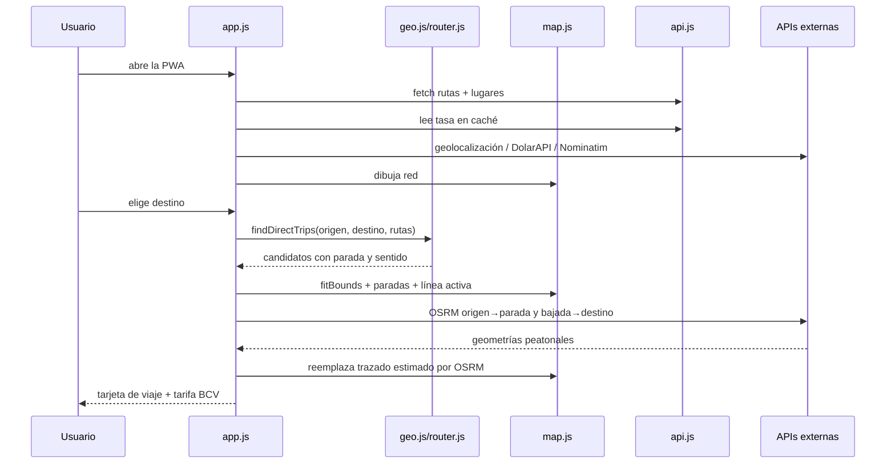
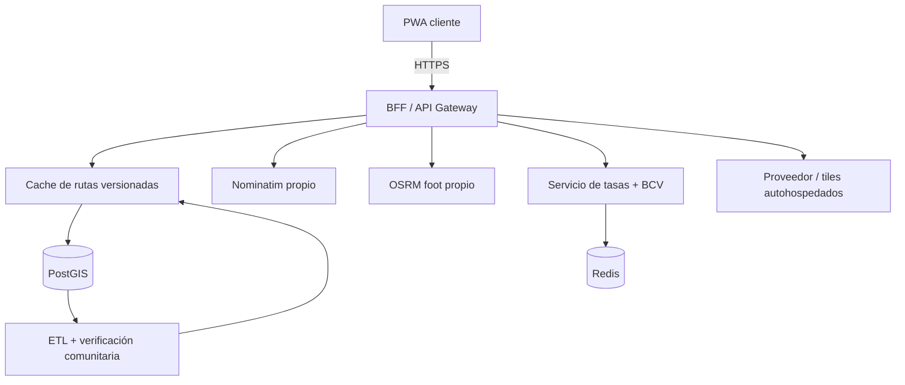

# Rapidito · Arquitectura de producto y técnica

Documento de decisiones para el MVP y para escalar el sistema sin reescribirlo.

---

## 1. Resumen ejecutivo

Rapidito es una PWA **client-first** para responder una pregunta concreta en la calle:

> «¿Qué línea tomo desde aquí hasta allá, en el sentido correcto, y cuánto cuesta hoy?»

La arquitectura separa tres cosas que suelen mezclarse en las apps de transporte informal:

1. **Datos de la ciudad** → `data/rutas.json`, GeoJSON externo, editable sin deploy de código.
2. **Lógica de decisión** → módulos puros (`geo.js`, `router.js`) ejecutados en el dispositivo.
3. **Presentación y proveedores** → UI, Leaflet, Nominatim, OSRM y DolarAPI detrás de adaptadores.

El MVP no tiene backend propio. Eso reduce el costo inicial y permite validar el problema con datos comunitarios. La ruta de producción sustituye los servicios públicos por un pequeño BFF (Backend-for-Frontend) y una base PostGIS, sin cambiar el contrato de datos ni el motor de matching del cliente.

---

## 2. Objetivos de producto

### Personas

| Persona | Necesidad | Tensión actual |
|---|---|---|
| **Pasajero ocasional** | Llegar a una dirección que no conoce. | No sabe qué línea pasa cerca ni en qué dirección. |
| **Trabajador de turno** | Calcular el pasaje antes de salir. | La tarifa cambia con el dólar y nadie la publica. |
| **Estudiante / adulto mayor** | Una interfaz legible, operable con una mano y bajo el sol. | Apps saturadas, fuentes pequeñas, jerga técnica. |
| **Validador comunitario** | Corregir una parada o una tarifa. | No existe un canal formal; el dato vive en el boca a boca. |

### North Star y métricas del MVP

**North Star:** *viajes resueltos con confianza* — una ruta directa mostrada con parada, sentido y pasaje dentro del mismo flujo.

Métricas que instrumentaría en producción:

- **Time-to-confidence** (< 30 s desde apertura hasta tarjeta de ruta).
- **Tasa de búsquedas con resultado** por zona y hora.
- **Uso del mapa de ruta** como confirmación (no solo leer la tarjeta).
- **Tasa de «sin ruta directa»** por corredor, para priorizar nuevas líneas.
- **Errores de sentido reportados** / viajes mostrados (objetivo: 0).
- **Datos validados** vs. propuestos por la comunidad.
- **Disponibilidad offline** y tasa de refresco exitoso de BCV.

### Fuera de alcance del MVP

- Transbordos multietapa.
- GPS en tiempo real de las unidades, ETA vivo u ocupación.
- Cuentas de usuario, pagos, reservas.
- Cobertura nacional o multi-ciudad en una sola instancia.
- Datos oficiales: no existen de forma pública y estructurada para todas las líneas.

Estas exclusiones son deliberadas para no inventar certeza donde no hay datos. La interfaz declara lo que sabe y lo que no.

---

## 3. Flujo del sistema

```mermaid
flowchart LR
    U[Persona en la calle] --> G[GPS · Geolocation API]
    U --> Q[Búsqueda de destino]
    Q --> N[Nominatim / OSM]
    U --> M[Tocar el mapa]
    N --> D[Destino normalizado]
    M --> R[Geocodificación inversa opcional]
    R --> D
    G --> O[Origen · [lon, lat]]
    D --> O

    subgraph Local["Dispositivo · sin backend propio"]
      O --> E[Motor de matching]
      NET[(rutas.json GeoJSON)] --> E
      E --> D1[Proyección sobre la línea]
      D1 --> D2[Avance acumulado por parada]
      D2 --> D3{Δ avance > 0 y caminata dentro del radio}
      D3 -- Sí --> C[Candidatos ordenados]
      D3 -- No --> X[Estado sin ruta / caminar]
      C --> UI[Bottom sheet + mapa]
      RATE[(Tasa BCV cacheada)] --> UI
    end

    UI --> L[Leaflet + tiles OSM oscurecidos]
    UI --> OSRM[OSRM · caminata punteada]
    UI --> DOL[DolarAPI · tasa oficial]
    DOL --> RATE
    UI --> W[Service Worker]
    W --> CACHE[(App shell + rutas + tiles visitados)]
```

### Secuencia principal



---

## 4. Módulos y límites

| Módulo | Responsabilidad | No debe conocer |
|---|---|---|
| `js/config.js` | Parámetros de ciudad, endpoints y radios de decisión. | Estado de UI. |
| `js/geo.js` | Matemática geográfica pura: haversine, proyección, longitud. | Leaflet, APIs, DOM. |
| `js/router.js` | Validación/normalización del GeoJSON y matching directo. | Leaflet, APIs, DOM. |
| `js/money.js` | Formatos es-VE y conversión USD → Bs. | Componentes. |
| `js/api.js` | Adaptadores Nominatim, OSRM y DolarAPI; caché local. | Estado de pantalla. |
| `js/map.js` | Render de red, marcadores, caminatas y encuadre. | Búsqueda, matching, tarifas. |
| `js/ui.js` | Vistas, sheet, diálogos, escape de HTML y feedback. | Fetch y geolocalización. |
| `js/app.js` | Orquestación del estado, eventos, flujo y PWA. | Detalle matemático. |
| `sw.js` | Caché de shell, datos, estáticos y tiles visitados. | Lógica del viaje. |

La dirección de dependencias es acíclica:

```text
index.html → app.js → ui.js / map.js / router.js / api.js → config.js
                           router.js → geo.js
                           api.js → geo.js + config.js
                           ui.js → money.js
```

Esto permite probar la parte difícil (geometría y matching) con Node sin navegador, y cambiar Leaflet o Nominatim sin tocar el algoritmo.

---

## 5. Modelo de datos

### 5.1 GeoJSON de la ciudad

`data/rutas.json` es la fuente de verdad. La app no importa el archivo: hace `fetch`, lo que permite publicar una red nueva sin recompilar. El archivo actual es una `FeatureCollection` vacía y la app la acepta como un estado válido: no muestra una pantalla de error, sino que invita a digitalizar las primeras líneas.

**Decisión central:** un Feature = un sentido de circulación. Una línea bidireccional se representa con dos Features (ida/vuelta). Ventajas:

- La geometría ya codifica la dirección.
- El motor no necesita invertir arreglos ni adivinar.
- El sesgo de una vía de un solo sentido queda explicado por los datos.
- La inspección de datos es directa en cualquier visor GeoJSON.

Las paradas se incluyen dentro de `properties.paradas` y se proyectan sobre la geometría al cargar. Se normalizan a un objeto interno:

```js
{
  id, groupId, groupName, direction, directionLabel,
  coords: [[lon, lat], ...],
  stops: [{ name, coord, alongMeters, originalIndex }],
  fareUsd: APP_CONFIG.fares.normalUsd,
  frequencyMin, color, lengthMeters
}
```

La tarifa normal no forma parte del GeoJSON: es una regla global de la app. `fareUsd` se normaliza desde `APP_CONFIG.fares.normalUsd` para que cualquier consumidor del router vea el mismo monto.

La red se agrupa por `grupo`; una tarjeta de línea no debe repetirse solo porque tiene ida y vuelta.

### 5.2 Datos editoriales

`data/lugares.json` contiene atajos, no rutas. Está separado para que un editor pueda cambiar los destinos sugeridos sin tocar la red.

### 5.3 Validación

`prepareNetwork()`:

- Exige `FeatureCollection` y geometrías `LineString` con coordenadas válidas.
- Descarta Features defectuosas y reporta `warnings` en lugar de tumbar toda la app.
- Valida el color antes de usarlo en CSS.
- Ordena paradas por avance y descarta las que no se pueden proyectar.
- Exige al menos dos paradas por sentido **solo si existe una Feature**.
- Acepta `features: []` sin lanzar una excepción.

Un dato malo degrada una línea, no la ciudad entera. Una red vacía es un estado inicial válido, no un error.

### 5.4 Evolución del modelo

En backend se propone:

```sql
cities(id, name, bbox, default_zoom)
routes(id, city_id, group_code, name, color, fare_usd, frequency_min)
route_directions(id, route_id, direction, from_name, to_name, geom geography(LineString, 4326))
stops(id, city_id, code, name, geom geography(Point, 4326), verified_at)
route_stops(route_direction_id, stop_id, sequence)
fare_versions(id, route_id, fare_usd, valid_from, source_id)
```

La API puede seguir sirviendo una `FeatureCollection` con el mismo contrato; el cliente no se entera del cambio.

---

## 6. Matching y validación de sentido

### 6.1 Proyección ortogonal en un plano local

Para cada segmento `A→B` de una linea y un punto `P`:

```text
lat0 = P.lat · π/180
x = (lon − P.lon) · R · (π/180) · cos(lat0)
y = (lat − P.lat) · R · (π/180)
```

Se buscan `A`, `B` y `P` en metros; `t` es la proyección escalar del vector `AP` sobre `AB`:

```text
t = clamp( (AP · AB) / |AB|² , 0, 1 )
proyección = A + t (B − A)
distancia = |AP − t·AB|
```

La distancia recorrida se acumula con la longitud haversine de cada segmento:

```text
along = Σ longitud(segmentos anteriores) + t · longitud(AB)
```

### 6.2 Condición de sentido

Para un par `subida` → `bajada`:

```text
Δ = along(bajada) − along(subida)
viaje_directo ⇔ Δ ≥ minRideM
```

Esto equivale a comprobar que la bajada está aguas abajo en el orden de la geometría. No se usa un simple «la línea pasa cerca de ambos puntos»: ese criterio es el que produce las recomendaciones en sentido contrario.

### 6.3 Selección de paradas

Para cada sentido:

1. Considerar paradas de subida con caminata estimada ≤ `maxWalkToStopM`.
2. Para cada una, considerar bajadas posteriores con caminata ≤ `maxWalkFromStopM`.
3. Calcular:

```text
caminata = distancia_recta × 1,22 / 4,8 km/h
espera   = frecuencia / 2
viaje    = Δ / 17 km/h + paradas intermedias × 18 s
total    = caminata_origen + espera + viaje + caminata_destino
```

4. Elegir el par de menor tiempo por recorrido; luego, por línea.
5. Calcular `originDistanceToLineM` con `projectOnLine(route.coords, origin)`. Es la distancia del origen al punto más cercano de **toda la línea**, independiente de la parada elegida.
6. Ordenar los resultados primero por `originDistanceToLineM` y luego por tiempo. La primera opción recibe el badge **“Más cerca a ti”**.
7. Devolver hasta tres alternativas.

Los factores (4,8 km/h, 17 km/h, 1,22) son parámetros documentados en `config.js`. No son datos de la ciudad; son supuestos del modelo y deben ajustarse con mediciones locales.

### 6.4 Por qué no un radio alrededor de la ruta

Se podría decir «la línea pasa a 100 m de origen y destino». Pero si no se verifica el orden, un pasajero puede terminar viajando en dirección opuesta. La proyección con avance acumulado es la unidad mínima de confianza. La UI agrega el sello **Sentido verificado** solo cuando se cumple esta condición.

### 6.5 Transbordos (siguiente iteración)

El MVP evita transbordos porque cada enlace adicional multiplica la incertidumbre de horario, tarifa y caminata. El habilitador técnico ya está: normalizar paradas y proyecciones permite tratar un viaje como un grafo de paradas con costo `tiempo + penalización de transbordo`, y resolverlo con Dijkstra/A* sobre un índice espacial. No se debe activar sin datos de frecuencia más confiables.

---

## 7. Tarifa

Pipeline:

1. `APP_CONFIG.fares.normalUsd` fija el pasaje normal en **0.25 USD** y `APP_CONFIG.fares.studentUsd` el estudiantil en **0.125 USD**.
2. `api.getOfficialRate()` consulta DolarAPI (`/v1/dolares/oficial`).
3. Se usa `promedio`; fallback a `venta`/`compra` si existiera.
4. Se cachea con `fetchedAt` y `apiUpdatedAt`.
5. `normalFareInBolivares(rate)` ejecuta `fareInBolivares(0.25, rate)` y `studentFareInBolivares(rate)` ejecuta `fareInBolivares(0.125, rate)`; ambos redondean a 2 decimales.
6. `fareTotalInBolivares(normalQty, studentQty, rate)` suma las tarifas unitarias por las cantidades elegidas en la calculadora.
7. La UI muestra USD y Bs.; si no hay tasa, muestra `Bs. —` y ofrece reintentar.

La tarifa en USD es una regla de producto; **la tasa de cambio sí es dinámica**. Si la API falla y hay caché, se usa y se marca como tal; si no hay caché, se declara desconocida. La UI no oculta el monto en USD cuando falta la tasa.

Riesgo de producto: DolarAPI no es el BCV, es un agregador. En producción:

- Proxy backend con `If-Modified-Since`, validación y múltiples fuentes.
- Sello de fuente y timestamp visibles.
- Alertas si la tasa difiere > X% de la fuente de respaldo.
- Tarifas versionadas por fecha, con historial y autor.

---

## 8. UX y sistema visual

### Principios

1. **Una mano, bajo el sol.** Controles ≥ 44 px, acciones principales en la parte baja, fuentes del sistema a 16–44 px.
2. **Glass UI compacta.** Un topbar de búsqueda tipo píldora y un bottom sheet de cristal sobre el mapa. No hay pantallas intermedias para llegar a la ruta.
3. **Dos colores.** Azul `#305CDE` y blanco/claro; el verde/ámbar solo codifica estados semánticos. Los colores de línea son variantes de azul declaradas en los datos.
4. **Legibilidad sobre el mapa.** Tiles OSM con filtro CSS oscuro; rutas con casing claro; caminata punteada; paradas de subida/bajada numeradas.
5. **La incertidumbre se comunica.** «Red pendiente de digitalización», «tarifa referencial», «tiempos estimados» y «sin seguimiento en vivo» están en la interfaz, no escondidos en un README.

### Componentes

- **Topbar:** marca, búsqueda con debounce y geolocalización.
- **Sugerencias:** Nominatim, recientes y opción de mapa; deduplicadas por topónimo y distancia.
- **Sheet:** tres estados principales (inicio, resultados, sin ruta) y uno de carga/error.
- **Tarjetas de viaje:** línea, destino del sentido, tarifa USD/Bs., caminata, bus, total, paradas, sello de dirección y badge **Más cerca a ti** en la primera opción.
- **Diálogos:** menú, líneas, tarifas, cómo funciona/privacidad e instalación.
- **Tema:** `data-theme` en `<html>`, persistido en `localStorage`; `theme-init.js` evita el flash.

La UI se renderiza con `textContent`/escape de todo valor externo. Las acciones se delegan con `data-action`; no hay handlers inline, lo que permite una CSP estricta.

### Accesibilidad

- Landmarks y skip link.
- Input etiquetado, `aria-expanded`, sugerencias navegables con flechas, Escape cierra.
- Foco atrapado en diálogos y devuelto al disparador.
- Región `aria-live` para anunciar el resultado del matching.
- `prefers-reduced-motion` desactiva animaciones.
- Contraste y tamaños pensados para exterior; se puede seguir mejorando con pruebas con usuarios reales.

### Presupuesto de rendimiento y 60 fps

La regla es simple: **el layout se calcula una vez; el compositor anima**.

- Las entradas de sheet, diálogos, sugerencias y vistas usan únicamente `transform` y `opacity`. No hay transiciones de `top`, `height`, `margin` ni `bottom`.
- `.map`, `.sheet`, `.dialog` y las vistas principales tienen `will-change: transform, opacity`. El mapa y el panel se promueven con `translateZ(0)`.
- El shimmer de skeletons es un pseudo-elemento que se mueve con `translateX`, no una animación de `background-position`.
- `-webkit-tap-highlight-color: transparent`, `touch-action: manipulation` y un `:active { transform: scale(0.97) }` agrupado dan feedback inmediato sin reflow.
- Los estados `:hover` están encapsulados en `@media (hover: hover) and (pointer: fine)`; en táctil no se aplican ni se quedan “pegados”.
- `env(safe-area-inset-bottom)` se usa en sheet, contenido, modales, toast y créditos para no chocar con la barra gestual.
- En `>=768px`, la búsqueda se limita a 450px, el panel lateral a 424–430px y los diálogos a 450px. El mapa conserva el resto del viewport.
- Un `ResizeObserver` en el contenedor del mapa, `window.resize`, `visualViewport.resize` y el evento **`rapidito:layoutchange`** (emitido al abrir/cerrar diálogos o cambiar el sheet) programan `map.invalidateSize({ pan: false })` en un solo frame. Así no aparecen recuadros grises y se mantiene la posición del mapa.

La validación se hace en Chromium con viewports de 320, 390, 768, 800, 1024 y 1440 px, comprobando `scrollWidth === innerWidth`, límites de panel, calles con nombres largos y resize sin errores de Leaflet.

---

## 9. PWA y offline

### Estrategia del service worker

| Recurso | Estrategia | Fallback |
|---|---|---|
| Navegación HTML | Red primero | Índice cacheado |
| `rutas.json`, `lugares.json` | Red primero | Última copia |
| JS/CSS/iconos/manifest | Caché primero + revalidación | Caché |
| Tiles OSM | Caché primero, solo visitados | Tile cacheado o error |

El precache incluye solo el shell y la red. No se descarga la ciudad entera ni se cachean APIs con datos personales. El tope de tiles evita que el almacenamiento crezca sin control.

### Qué funciona offline

- Abrir la app y ver la red.
- Elegir atajos, destinos recientes o un punto del mapa.
- Calcular rutas localmente.
- Ver la última tasa cacheada.
- Intentar caminatas; si OSRM falla, quedan las líneas rectas punteadas.

### Qué no funciona offline

- Buscar una dirección nueva (Nominatim).
- Refrescar la tasa BCV.
- Ver tiles de zonas nunca visitadas.
- Descargar datos nuevos de la red.

### Actualización

`sw.js` usa una versión de caché. En cada deploy que cambie el shell:

1. Subir `VERSION` en `sw.js`.
2. Esperar la instalación; la app ofrece «Actualizar».
3. El nuevo worker hace `skipWaiting` y la página se recarga.

---

## 10. Fallos y degradación

| Fallo | Comportamiento |
|---|---|
| GPS denegado/no disponible | Origen de muestra visible (centro de Barquisimeto), botón para reintentar. |
| `rutas.json` vacío | Estado inicial válido: la app funciona y ofrece digitalizar líneas. |
| `rutas.json` inválido | Se descartan las Features inválidas; si no queda red, se muestra error accionable. |
| Nominatim caído | Mensaje en sugerencias; el usuario puede elegir en el mapa o un reciente. |
| OSRM caído | La ruta del bus sigue; la caminata queda como línea recta punteada. |
| DolarAPI caída con caché | Tarifa en Bs. con la última tasa guardada y aviso de caché. |
| DolarAPI caída sin caché | `Bs. —`, no se inventa una tasa. |
| Sin conexión | Banner persistente, cálculo local y opciones offline. |
| Fuera de cobertura | Estado «sin ruta directa» con opción de explorar líneas y probar otro destino. |
| Servicio público lento | Timeouts y abortos; la UI no bloquea el flujo principal. |

---

## 11. Seguridad y privacidad

- **CSP** en `index.html`: scripts solo `self`, workers `self`, conexiones solo a los dominios declarados.
- **XSS:** todo texto externo se escapa antes de entrar al DOM; los colores se validan con regex; no se interpola HTML en atributos que no sean de clase/estilo controlado.
- **URLs externas:** `target="_blank"` con `rel="noopener noreferrer"`.
- **Datos personales:** no hay backend ni cuentas. La ubicación no se envía a Rapidito.
- **Terceros:** las coordenadas de caminata se envían a OSRM; el texto de búsqueda a Nominatim. Se documenta en «Cómo funciona y privacidad».
- **Almacenamiento local:** tema, recientes, caché de búsquedas (24 h) y tasa. El usuario puede borrarlo desde el navegador.
- **Dependencias:** Leaflet vendorizado con versión fija. Sin CDN, sin trackers.

En producción, el backend debe añadir rate limiting, validación de esquema, logs sin coordenadas personales y una política de retención explícita.

---

## 12. Rendimiento y escalado

### Situación actual

- Sin framework de UI.
- Leaflet local (~148 KB) y CSS propio (~60 KB).
- `rutas.json` actual ~0 KB (sin Features). Cuando se digitalice la ciudad, conviene mantener geometrías simplificadas y servir la red por versión/ciudad.
- Matching en el cliente: O(rutas × paradas²). Con cientos de paradas sigue siendo liviano; para miles, usar índice espacial (R-tree) y candidatos previos por corredor.
- Un solo fetch de datos; las caminatas se piden únicamente al seleccionar una opción.

### Siguiente arquitectura



Claves:

- **BFF** para centralizar rate limits, CORS, claves y observabilidad.
- **PostGIS** para rutas, paradas y búsquedas espaciales.
- **Versionado de datos** (`data_version`) y ETags; la PWA cachea por versión.
- **OSRM foot propio** o un motor peatonal equivalente.
- **Tiles** con contrato de uso y atribución.
- **Feature flags** para transbordos, ciudades nuevas y experimentos.

### Escalar la red de datos

El cuello de botella real no es el código, sino la cobertura y confianza. El producto necesita:

- Un flujo de propuesta/corrección/revisión con roles.
- Snapshots y auditoría de cambios.
- Puntos de control: tarifa, parada, geometría, sentido, horario.
- Métricas de discrepancia y feedback de pasajeros.
- Mecanismos para que un conductor o colectivo valide una tarifa.

---

## 13. Pruebas y calidad

- **Unitarias:** `geo.js` y `router.js`; `money.js`.
- **Datos:** se carga el GeoJSON real; se comprueba que una red vacía no rompa la app y que fixtures con dos líneas se ordenen por cercanía.
- **Browser smoke tests** (manuales y reproducibles con Playwright):
  - GPS permitido/denegado.
  - Búsqueda, deduplicación, selección.
  - Walking OSRM.
  - Tema persistente.
  - Map pick + geocodificación inversa.
  - Offline y service worker.
- **Checklist de release:** tests, validar JSON, subir versión de SW, probar en móvil real, revisar consola, revisar atribución y datos demo.

Automatizaciones deseables: Playwright en CI, Lighthouse PWA/performance, validación JSON Schema del GeoJSON y un job que detecte rutas con `Δ` inconsistente.

---

## 14. Roadmap

### Fase 1 · Base operable (este repositorio)

- Red GeoJSON externa preparada para digitalización.
- GPS + Nominatim + mapa + matching con sentido.
- Pasajes normal (USD 0,25) y estudiantil (USD 0,125) × BCV.
- Prioridad por distancia de la línea al origen y badge de cercanía.
- PWA offline y Glass UI.
- Documentación y pruebas.

### Fase 2 · Datos confiables (siguiente)

- Backend de datos con PostGIS y versionado.
- Panel de validación comunitaria.
- Fuentes múltiples de tarifa y fecha de vigencia.
- Digitalizar y validar la red real de Barquisimeto por corredores.
- BFF para Nominatim/OSRM/DolarAPI.
- Observabilidad de calidad: «no encontré ruta» y correcciones.

### Fase 3 · Viaje completo

- Transbordos con grafo y penalización.
- Puntos de interés y favoritos.
- Historial local y accesibilidad por línea.
- Compartir viaje por enlace con coordenadas (opt-in).
- Tiles y OSRM propios.

### Fase 4 · Tiempo real (solo con datos reales)

- Integración con operadores o GPS comunitario.
- ETA y ocupación con contrato de calidad.
- Alertas y desvíos.
- Nunca mostrar un ETA inventado para aparentar tiempo real.

---

## 15. Registro de decisiones (ADR resumido)

| # | Decisión | Motivo | Consecuencia |
|---|---|---|---|
| 1 | Vanilla JS + CSS nativo | Peso mínimo, control visual, cero build y offline simple. | Más disciplina manual de componentes y testing. |
| 2 | GeoJSON en archivo externo | Cero hardcoding; editor de datos sin tocar app. | Necesita validación y versionado en producción. |
| 3 | Un Feature por sentido | El sentido se vuelve un dato explícito y comprobable. | Duplica geometrías en la red. |
| 4 | Matching en cliente | Privacidad, rapidez y funcionamiento con red vacía. | Repetir cálculo por dispositivo; mover a backend si la red crece. |
| 5 | Sin tasa de respaldo fija | Una tasa inventada destruye la propuesta de confianza. | La app puede quedarse sin monto en Bs. si no hay caché. |
| 6 | OSRM solo para el dibujo de caminata | La geometría peatonal mejora la lectura; el tiempo se calcula localmente. | Depende de un servicio público en la demo. |
| 7 | Sin transbordos en el MVP | Evita falsas certezas y mantiene el producto simple. | Cobertura limitada; se prioriza en fase 3. |
| 8 | Dark mode en localStorage | Preferencia persistente sin cuenta. | No se sincroniza entre dispositivos. |
| 9 | PWA sin backend | Lanzamiento rápido y bajo costo. | Sin moderación centralizada ni datos en vivo. |
