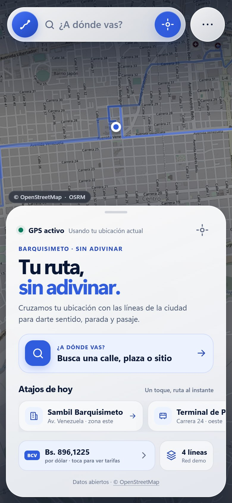
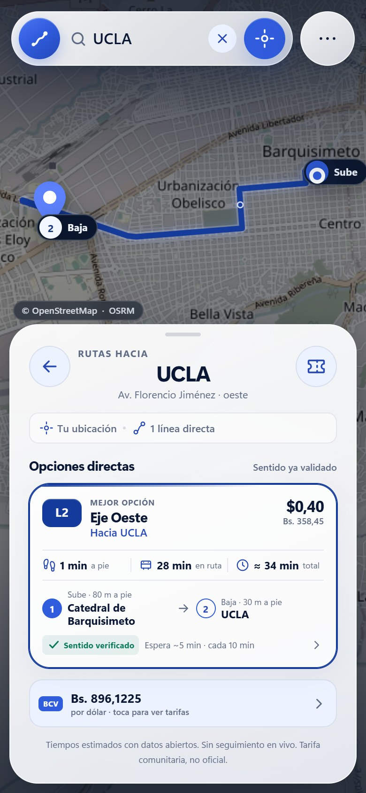
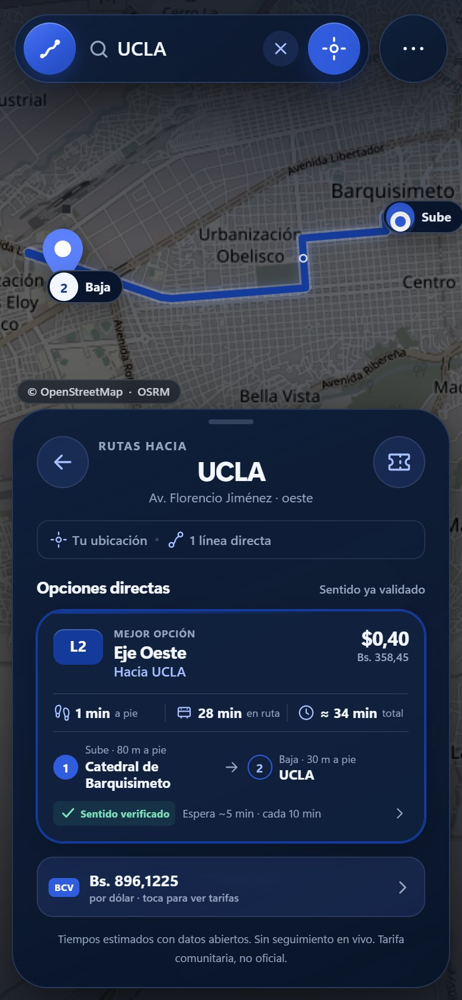
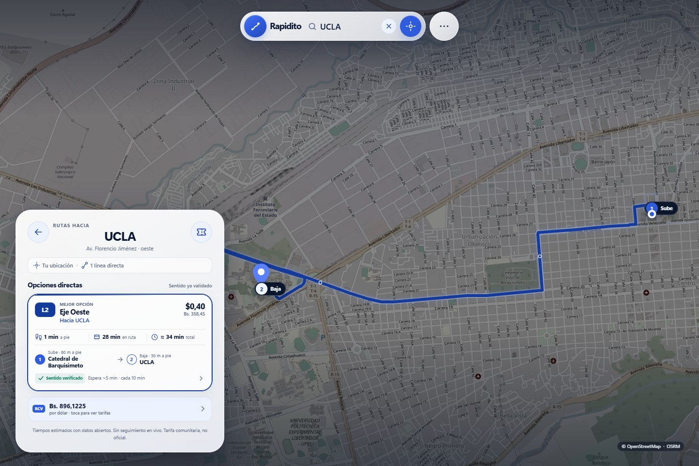

# Rapidito

**PWA de transporte urbano para Barquisimeto.** Convierte el “sistema fantasma” de rutas, paradas y tarifas en una respuesta visual: qué línea te sirve, en qué sentido va, dónde subes y cuánto pagas.

> **Estado:** app funcional con la **red vacía**, lista para que se digitalicen y validen las líneas reales de Barquisimeto. El pasaje normal está fijado en **USD 0,25** y el estudiantil en **USD 0,125**; ambos se convierten con la tasa BCV. La app arranca, busca destinos y muestra su estado sin fallar cuando `data/rutas.json` no tiene Features.

---

## El problema, en tres incertidumbres

| Incertidumbre | Respuesta de Rapidito |
|---|---|
| **Geográfica** | Cruza el GPS (Geolocation API) y el destino (Nominatim/OSM) contra la geometría de la red y muestra la mejor combinación de paradas. |
| **De sentido** | Proyecta cada parada sobre la línea y compara el avance acumulado. Si la bajada no está delante de la subida, la línea se descarta. |
| **Financiera** | Aplica el pasaje normal fijo de **USD 0,25** y el estudiantil de **USD 0,125**, y los convierte a bolívares con la tasa oficial BCV que publica DolarAPI. Nunca inventa una tasa si la API falla. |

La red no está en el código: vive en `data/rutas.json` como **GeoJSON FeatureCollection de LineStrings**. Puedes añadir o editar líneas sin tocar el HTML ni el JavaScript.

---

## Capturas de referencia visual

> Las imágenes siguientes se tomaron con una red de ejemplo anterior. La red de datos actual está vacía hasta que se digitalicen las líneas; no representan rutas activas.

| Inicio · móvil | Resultados · móvil | Tema oscuro |
|---|---|---|
|  |  |  |

**Adaptación a PC:** el mapa ocupa el fondo; búsqueda, panel y modales quedan limitados a 450px.



> Estas capturas ilustran el diseño Glassmorphism y el layout responsive; no son evidencia de datos de transporte activos.

---

## Arranque local

Requisitos: **Node.js 20+**. No hay build, ni framework, ni dependencias de producción.

```bash
npm start
```

Abre **http://127.0.0.1:4321**. En otro puerto:

```bash
PORT=8080 npm start
```

En Windows PowerShell:

```powershell
$env:PORT=8080; npm start
```

> La geolocalización y los service workers requieren HTTPS o `localhost`. Si abres `index.html` con `file://`, el navegador bloqueará `fetch` y GPS.

El primer arranque necesita internet para descargar los tiles y llamar a las APIs. Después, el service worker permite abrir la app y calcular rutas con la red guardada. La búsqueda de direcciones nuevas y el trazado peatonal de OSRM requieren conexión; sin ella puedes usar destinos recientes o tocar el mapa.

### Pruebas

```bash
npm test
```

25 pruebas cubren proyección geométrica, validación de sentido, prioridad de cercanía, red vacía sin errores, selección de paradas, estado “caminar”, pasajes normal y estudiantil, total de la calculadora, fechas de tasa y conversión tarifaria.

### Desarrollar con service worker

El service worker sirve JS/CSS desde caché y revalida en segundo plano. Al editar el shell:

- Recarga dos veces para ver el JS nuevo, o usa **DevTools → Application → Service Workers → Update on reload**.
- Si cambias el shell de forma importante, sube `VERSION` en `sw.js` y prueba el flujo de actualización.
- El servidor de desarrollo envía `Cache-Control: no-store`; no ocurre lo mismo en producción.

---

## Flujo de uso

1. La app pide GPS al abrir. Si no hay permiso, usa el centro de Barquisimeto como ubicación de muestra y lo deja visible.
2. Busca un destino con Nominatim (o usa los atajos, destinos recientes o “Elegir en el mapa” para modo offline).
3. Si la red está vacía, la app lo informa y no lanza errores; cuando existan líneas, `findDirectTrips()` busca pares de paradas subida→bajada dentro de un radio peatonal.
4. Las líneas se ordenan por la distancia de su punto más cercano al origen. La primera lleva el badge **“Más cerca a ti”**.
5. La opción elegida se dibuja en el mapa, con el trazado peatonal de OSRM en línea punteada.
6. Los pasajes normal (**USD 0,25**) y estudiantil (**USD 0,125**) se muestran en bolívares con la tasa oficial BCV; la tarjeta inferior y la calculadora conservan también la referencia en dólares.
7. El tema claro/oscuro se guarda en `localStorage`; la tasa se cachea para evitar llamadas innecesarias y funcionar sin red.

---

## Rendimiento y adaptabilidad

La interfaz se diseñó para moverse a **60 fps** en teléfonos de gama media y para no convertirse en una web estirada en PC.

### En móvil

- Las animaciones del **bottom sheet**, los **modales**, las **vistas** y las **sugerencias** usan únicamente `transform` y `opacity`; no se animan `top`, `height` ni `margin`.
- Las capas pesadas (`.map`, `.sheet`, vistas y diálogos) llevan `will-change: transform, opacity` y `translateZ(0)` para promoverlas al compositor.
- El shimmer de carga se reimplementó con un pseudo-elemento animado mediante `transform`, no con `background-position`.
- Se eliminó el tap azul de Android (`-webkit-tap-highlight-color: transparent`) y los controles responden con `transform: scale(0.97)` en `:active`.
- Los `padding-bottom` y offsets inferiores usan `env(safe-area-inset-bottom)` para no chocar con el home indicator.
- Los hovers están encapsulados en `@media (hover: hover) and (pointer: fine)`, por lo que no se quedan pegados al tocar.

### En PC y tablet

- El breakpoint principal es **`@media (min-width: 768px)`**.
- La píldora de búsqueda se limita a **450px**; el panel de rutas flota abajo a la izquierda con **424px** (430px en pantallas grandes); los modales no superan **450px**. El mapa ocupa todo el fondo.
- Los estados `:hover` sutiles solo se activan con ratón.
- El ajuste del viewport de Leaflet se coordina con `ResizeObserver`, `window.resize`, `visualViewport.resize` y un evento interno `rapidito:layoutchange` que se emite al abrir/cerrar diálogos o cambiar el contenido del sheet. El controlador llama `map.invalidateSize({ pan: false })` una vez por frame.
- La vista de resultados en PC reserva el espacio del panel izquierdo al calcular el `fitBounds`, evitando que la ruta quede debajo del cristal.

## Estructura de archivos

```text
Rapidito X/
├── index.html                     # Shell de la app, sprite SVG, CSP y landmarks
├── manifest.webmanifest           # Instalación PWA, iconos y colores
├── sw.js                          # Offline: shell, datos, estáticos y tiles visitados
├── css/
│   └── app.css                    # Design system nativo, Glass UI, dark mode, responsive
├── js/
│   ├── app.js                     # Controlador: estado, eventos, flujo de viaje
│   ├── api.js                     # Nominatim, OSRM, DolarAPI y datos locales
│   ├── config.js                  # Ciudad, endpoints y parámetros de matching
│   ├── geo.js                     # Haversine, proyección sobre polilíneas
│   ├── map.js                     # Leaflet, capas, marcadores y encuadre
│   ├── money.js                   # Formato es-VE y conversión USD → Bs.
│   ├── router.js                  # Normalización GeoJSON + motor de matching
│   ├── theme-init.js              # Tema antes del primer paint
│   └── ui.js                      # Vistas, sheet, diálogos y búsqueda visual
├── data/
│   ├── rutas.json                 # RED VACÍA · recibe las líneas reales (GeoJSON)
│   ├── rutas.schema.json          # Contrato JSON Schema para autoría/CI
│   └── lugares.json               # Atajos editoriales de Barquisimeto
├── vendor/leaflet/                # Leaflet 1.9.4 local + licencia
├── assets/icons/                  # Iconos PWA, favicon y fuente SVG
├── scripts/
│   └── serve.mjs                  # Servidor estático de desarrollo, sin deps
├── tests/
│   ├── geo.test.mjs
│   ├── money.test.mjs
│   └── router.test.mjs
├── docs/screenshots/
├── ARCHITECTURE.md                # Decisiones, modelo de datos, escalado
└── package.json
```

---

## La red: `data/rutas.json`

El archivo actual está **vacío a propósito** y la app lo acepta como un estado válido:

```json
{
  "type": "FeatureCollection",
  "name": "Red de Barquisimeto · pendiente de digitalización",
  "city": "Barquisimeto, Venezuela",
  "disclaimer": "La red aún no tiene líneas digitalizadas...",
  "features": []
}
```

Cada `Feature` que agregues representará un recorrido **en un solo sentido**. Para una línea bidireccional se publican dos Features del mismo `grupo` (ida y vuelta), con la geometría y las paradas invertidas. Así el motor nunca tiene que inventar el sentido contrario. Este es el formato de una línea cuando la digitalices:

```json
{
  "type": "Feature",
  "id": "L1-I",
  "properties": {
    "id": "L1-I",
    "grupo": "L1",
    "nombre": "Eje Venezuela",
    "sentido": "ida",
    "origen": "Terminal de Pasajeros",
    "destino": "Sambil Barquisimeto",
    "color": "#305CDE",
    "frecuenciaMin": 8,
    "horario": "05:30–21:30",
    "paradas": [
      { "nombre": "Terminal de Pasajeros", "coord": [-69.334072, 10.069132] },
      { "nombre": "Catedral de Barquisimeto", "coord": [-69.321431, 10.073631] }
    ]
  },
  "geometry": {
    "type": "LineString",
    "coordinates": [[-69.334072, 10.069132], [-69.321431, 10.073631]]
  }
}
```

La tarifa **no** se guarda por línea: es una regla de la app (`APP_CONFIG.fares.normalUsd = 0.25`).

### Contrato mínimo por Feature

| Campo | Tipo | Uso |
|---|---|---|
| `id` | string | Identificador único del recorrido (sentido incluido). |
| `grupo` | string | Código visible de la línea (`L1`). Agrupa ida/vuelta y evita duplicar tarjetas. |
| `nombre` | string | Nombre del corredor. |
| `sentido` | `"ida"` / `"vuelta"` | Auditoría del recorrido. |
| `origen`, `destino` | string | Rotulado de la dirección (“Hacia Sambil Barquisimeto”). |
| `color` | `#RRGGBB` | Color del corredor; validado antes de insertarse en el DOM. |
| `frecuenciaMin` | number | Frecuencia; la espera se estima como la mitad. |
| `paradas` | array | `{ nombre, coord: [lon, lat] }` en el orden del recorrido. Imprescindible. |
| `geometry` | LineString | Trazado vial en `[longitud, latitud]`. |

El contrato completo está en [`data/rutas.schema.json`](data/rutas.schema.json) (JSON Schema 2020-12). Acepta `features: []` y ya no exige `tarifaUSD`. Úsalo en el editor o en CI para detectar una línea mal formada antes del deploy.

**Para añadir una línea:** añade sus dos Features (ida/vuelta), usa IDs nuevos y ejecuta `npm test`. Si cambias el contenido del shell o quieres forzar la actualización del service worker, sube `VERSION` en `sw.js`. No hay que tocar `index.html` ni `app.js`.

---

## Cómo funciona el motor de sentido

En `js/geo.js`, cada punto se proyecta ortogonalmente sobre cada segmento de la LineString usando un plano local en metros. Para cada punto se obtiene:

- `point`: coordenada ajustada a la vía.
- `distanceMeters`: distancia perpendicular.
- `alongMeters`: distancia recorrida desde el inicio de la ruta.

Con dos paradas candidatas:

```text
Δ = alongMeters(bajada) − alongMeters(subida)
```

Solo hay viaje directo si **Δ > 0** y la distancia de viaje supera un mínimo. Esa condición es la que impide sugerir una línea que va en sentido contrario, aunque pase cerca de ambos puntos.

El motor también:

- Exige que el origen esté a una caminata razonable de una parada de subida y el destino de una de bajada.
- Estima caminata con un factor de desvío de 1,22 sobre la línea recta.
- Calcula `originDistanceToLineM`: la distancia del **origen al punto más cercano de toda la geometría de la línea**.
- Ordena las opciones primero por `originDistanceToLineM` y solo después por tiempo. La primera muestra el badge **“Más cerca a ti”**.
- Deduplica por `grupo`, priorizando el sentido cuya geometría pase más cerca del origen.

La implementación está aislada de Leaflet y del DOM en `js/router.js`; por eso se puede probar en Node. El detalle matemático y de escalado está en [ARCHITECTURE.md](ARCHITECTURE.md).

---

## Pasajes: USD 0,25 normal y USD 0,125 estudiantil × BCV

- `APP_CONFIG.fares.normalUsd` fija el pasaje normal en **0.25 USD**.
- `APP_CONFIG.fares.studentUsd` fija el pasaje estudiantil en **0.125 USD**.
- La app llama a `https://ve.dolarapi.com/v1/dolares/oficial` y usa `promedio` (o `venta`/`compra` si hiciera falta).
- `normalFareInBolivares(rate)` multiplica `0.25 × tasa` y redondea a dos decimales.
- `studentFareInBolivares(rate)` multiplica `0.125 × tasa` y redondea a dos decimales.
- `fareTotalInBolivares(normalQty, studentQty, rate)` suma las cantidades elegidas usando las tarifas unitarias ya redondeadas.
- La calculadora del modal permite ajustar ambas cantidades con +/− y actualiza el total en vivo.
- La tasa se guarda en `localStorage` y se reutiliza desde caché si la red falla. En la interfaz se indica cuando es una tasa guardada.
- Si nunca hubo tasa, se muestra `Bs. —`; jamás se usa una tasa fija hardcodeada.

El precio final en bolívares se muestra en la tarjeta inferior, la calculadora de pasajes y las tarjetas de ruta, incluso cuando todavía no hay líneas.

---

## APIs externas y política de uso

| Servicio | Uso | Nota para producción |
|---|---|---|
| **Nominatim** | Búsqueda y geocodificación inversa. | Límite de 1 req/s, caché de 24 h, `Accept-Language: es`, viewbox de Barquisimeto con `bounded=1`. Usa una instancia/proxy propio y configura `contactEmail` en `js/config.js`. |
| **OSRM demo público** | Geometría de caminata punteada. | El servidor público responde con perfil de coche; la app **no usa su `duration`**, calcula la caminata a 4,8 km/h. Despliega OSRM con perfil `foot` y respeta su política de uso. |
| **DolarAPI** | Tasa oficial BCV. | Sin SLA. En producción añade un proxy con caché y validación; contrasta la fuente BCV. |
| **OpenStreetMap tiles** | Mapa base oscurecido por CSS. | El servidor estándar de tiles no es para alto tráfico. Migra a un proveedor con contrato o tiles autohospedados. Atribución obligatoria. |
| **Leaflet** | Motor de mapas. | Incluido localmente (`vendor/`); licencia BSD-2-Clause. |

Las llamadas desde el navegador requieren que los servicios tengan CORS. La política de seguridad del documento está en `index.html` (`Content-Security-Policy`). Si cambias proveedores, actualiza también `connect-src`, `img-src` y `js/config.js`.

---

## Modo offline

El service worker (`sw.js`) precachea:

- HTML, CSS, JS y Leaflet local.
- `data/rutas.json` y `data/lugares.json`.
- Manifest e iconos.

Estrategias:

- **Navegación:** red primero, índice cacheado como fallback.
- **Datos de la ciudad:** red primero, copia local.
- **Estáticos propios:** caché primero + revalidación en segundo plano.
- **Tiles OSM:** solo los visitados, con un tope de 180 entradas.

Sin conexión puedes:

- Abrir la app y ver la red guardada.
- Elegir destinos recientes, atajos o tocar el mapa (la geocodificación inversa se omite).
- Calcular rutas localmente.
- Ver la última tasa BCV.
- Ver caminatas con un trazo recto punteado como respaldo si OSRM no responde.

La primera carga de la app requiere conexión. Los tiles fuera de la zona ya visitada no estarán disponibles sin red. El service worker no guarda consultas de Nominatim ni respuestas de OSRM/DolarAPI.

> En esta versión el buscador de Nominatim está limitado con `bounded=1` al viewbox de Barquisimeto para que “Sambil” no devuelva resultados de Margarita. Al cambiar de ciudad, actualiza ese viewbox en `js/config.js`.

---

## Configuración

Todo está centralizado en `js/config.js`:

- `city`: centro, zoom, país y viewbox de búsqueda.
- `data.routesUrl` / `data.placesUrl`: red y atajos de la ciudad.
- `nominatim`: endpoint, idioma, debounce, intervalo mínimo, caché y email de contacto.
- `osrm`: endpoint, perfil y timeout.
- `dolarApi`: endpoint y ventanas de refresco.
- `routing`: radios de caminata, velocidades, espera y máximo de alternativas.
- `fares.normalUsd` / `fares.studentUsd`: pasajes fijos de **0,25 USD** y **0,125 USD**.
- `demo.origin`: ubicación de muestra si el GPS no está disponible.

Para cambiar de ciudad: actualiza `city`, `rutas.json`, `lugares.json` y, si aplica, el texto de marca. La lógica no necesita cambios.

---

## Pruebas realizadas

- **25/25 tests** de Node en verde.
- Prueba manual en Chromium (escritorio y móvil emulado):
  - Arranque con `rutas.json` vacío, sin errores ni pantalla de fallo.
  - Selección de un destino sin red: mensaje «La red está lista para digitalizarse».
  - GPS concedido y denegado (fallback visible).
  - Búsqueda en Nominatim de Barquisimeto con `bounded=1`, ranking, deduplicación de topónimos y descarte de resultados de otras ciudades.
  - Matching en ambos sentidos y bloqueo del sentido contrario con redes de prueba.
  - Orden por cercanía al origen y badge «Más cerca a ti» con dos líneas inyectadas: la más cercana aparece primera aunque sea más lenta.
  - Tarjeta con pasajes normal de **$0,25** y estudiantil de **$0,125**, y conversión dinámica a Bs. con tasa de prueba.
  - Calculadora de pasajes con controles +/−, total en vivo y límites de cantidad.
  - Modal de tarifas, modo oscuro persistente, selección en mapa, caminata OSRM y offline.
  - Responsive en 320, 390, 768, 800, 1024 y 1440px; sin scroll horizontal; límites de 450px para búsqueda/modales y 424–430px para el panel; resize y apertura/cierre de diálogos sin errores de Leaflet.
- Validación de sintaxis con `node --check` en todos los módulos y el service worker.
- Auditoría CSS: sin transiciones de `top`, `height`, `margin` ni `bottom`; hovers encapsulados en puntero fino; shimmer basado en `transform`.

---

## Limitaciones conocidas

- **La red está vacía.** No hay líneas cargadas hasta que se digitalicen y validen en `data/rutas.json`.
- **Solo viajes directos.** No hay transbordos ni planificación multi-línea todavía.
- **No hay datos en vivo** de unidades, llegadas ni ocupación.
- **La tarifa normal es una regla de producto.** La tasa BCV se consulta en vivo; la tarifa en Bs. debe validarse contra la operación real.
- **Geocodificación y caminata dependen de servicios públicos** en esta implementación. Para producción se requieren instancias propias/proxy.
- **Los tiles offline son limitados** a lo ya visitado.
- **No hay backend**: sin cuentas, sin moderación de datos y sin tasas de cambio propias. Es una decisión deliberada para el MVP.

La hoja de ruta para convertirlo en producto operativo (verificación comunitaria, PostGIS, OSRM propio, transbordos, analytics de calidad de datos y transporte en tiempo real) está en [ARCHITECTURE.md](ARCHITECTURE.md).

---

## Créditos

- Mapa y datos: [© OpenStreetMap contributors](https://www.openstreetmap.org/copyright), ODbL.
- Geocodificación: [Nominatim](https://nominatim.org/).
- Ruteo peatonal: [OSRM](https://project-osrm.org/).
- Tasa: [DolarAPI](https://ve.dolarapi.com/), fuente BCV.
- Mapa interactivo: [Leaflet](https://leafletjs.com/), BSD-2-Clause.
- Tipografía: fuentes del sistema; no se descargan webfonts.
